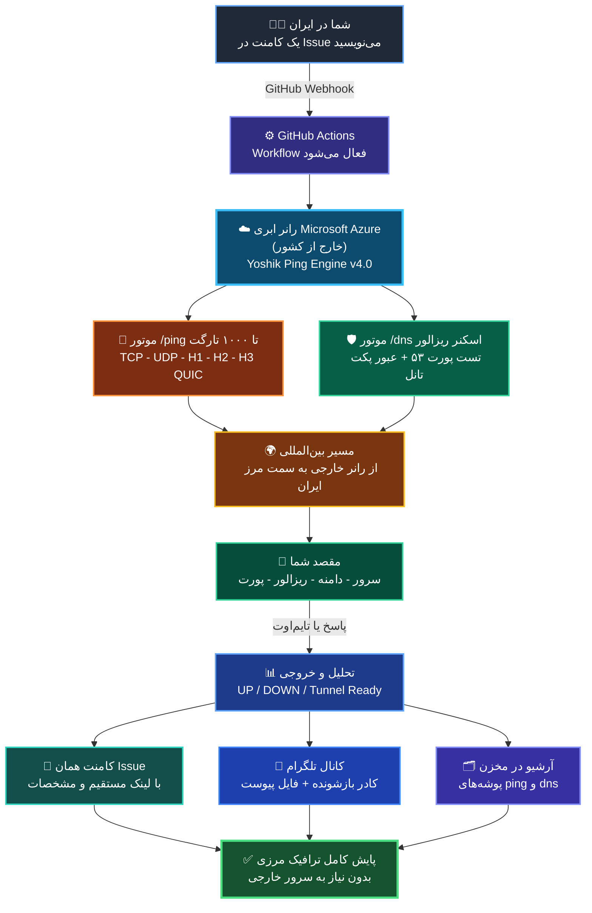

<div align="center">


<br/><br/>

#  یوشیک پینگ نسخه ۴.۰ &nbsp;|&nbsp; 🇬🇧 Yoshik Ping Engine `v4.0`

### سامانه ابری پایش عمیق ترافیک مرزی، اسکنر ریزالور و تانل DNS، و ماتریس لایه‌های وب

**Serverless Cross-Border Deep Telemetry, DNS Tunnel Sentinel & Modern Web Matrix (H1/H2/H3)**

[](https://github.com/YoshikVPS/YoshikPing/actions)
[](https://python.org)
[](#-ماتریس-فنی-تحلیل-پروتکل‌ها-و-سوکت‌ها)
[](https://t.me/YoshikVPS)
[](https://github.com/YoshikVPS/YoshikPing/releases)

<br/>

[](https://github.com/YoshikVPS/YoshikPing/fork)
[](https://github.com/YoshikVPS/YoshikPing/issues/new)
[](https://github.com/YoshikVPS/YoshikPing/releases/latest)

<br/>

**<a href="#persian-docs">📖 مطالعه مستندات جامع مهندسی فارسی و سناریوهای شبکه</a>** &nbsp; | &nbsp; **<a href="#english-docs">🇬🇧 Jump to English Documentation</a>**

</div>

---

<a id="persian-docs"></a>

#  مستندات تخصصی فارسی | سامانه یوشیک پینگ ۴.۰

###  این پروژه دقیقاً چطور کار می‌کند؟ (نمای سه‌بعدی از بیرون مرز به داخل)



---

###  قابلیت‌های جدید در نسخه ۴.۰

1. **موتور تست ریزالور و تانل DNS (`/dns`):**
   - تست موازی و ایمن لیست‌های طولانی آی‌پی روی پورت ۵۳ (`udp` و `tcp`) با الهام از ساختار **WhiteDNS / CottenDNS**.
   - بررسی واقعی بودن ریزالور و تست عبور پکت‌های ساب‌دامین/تانل.
   - تخمین زمان اتمام اسکن در شروع کار و ذخیره ریزالورهای سالم در پوشه جداگانه `dns/` با تاریخ شمسی.
2. **ارتقای موتور `/ping` به مقیاس ۱۰۰۰ تارگت:**
   - بهینه‌سازی همزمانی برای تست روان تا ۱۰۰۰ دامنه و آی‌پی همزمان.
   - استفاده از **نقل‌قول بازشونده تلگرام (`Expandable Blockquote`)** برای نمایش تمیز گزارش‌های طولانی و ارسال خودکار فایل `.txt` در صورت عبور از سقف ۴۰۹۶ کاراکتر.
   - نمایش ثابت IP عمومی رانر اکشنز در خروجی هر دو موتور.

---

###  دستورات کاربردی در ایشیو (ChatOps v4.0)

تمامی دستورات در بخش کامنت‌های **Issue** مخزن ثبت می‌شوند:

#### حالت ۱: پایش عمیق لایه ۴ و ۷ شبکه (`/ping`)

پایش همزمان تا ۱۰۰۰ تارگت، نمایش IP رانر، ذخیره در `ping/` و ارسال گزارش فشرده به کانال تلگرام:

```text
/ping arvancloud.ir:443(https) cloudflare.com:443(https:h3,udp) 1.1.1.1:53(udp) (تایم)-1 @YoshikVPSBOT
```

*(برای خروجی خالص IPهای سالم، فلگ `-txt` را اضافه کنید: `(تایم)-1-txt`)*.

#### حالت ۲: اسکن ریزالور و تانل DNS (`/dns`)

تست موازی لیست ریزالورها روی پورت ۵۳ (`udp`، `tcp` یا هر دو) و ذخیره سالم‌ها در پوشه `dns/`:

```text
/dns 1.1.1.1:53(udp,tcp) 8.8.8.8:53(udp) -txt @YoshikVPSBOT
```

*(اگر `@YoshikVPSBOT` را نگذارید، اسکن انجام و در مخزن ذخیره می‌شود اما در کانال منتشر نمی‌شود).*

#### حالت ۳: بایگانی هوشمند سورس پروژه (`بایگانی`)

بسته‌بندی فایل‌های اصلی در قالب ZIP، ثبت در بخش Releases با تگ `v4.0`، جلوگیری از نسخه تکراری و اطلاع‌رسانی در تلگرام:

```text
بایگانی-@YoshikVPSBOT
```

#### حالت ۴: پاک‌سازی سوابق و پوشه‌های لاگ

- تخلیه تاریخچه تب Actions: **`اکشنز-پاک`**
- حذف دو مرحله‌ای پوشه‌های `ping/` و `dns/`: **`پاکسازی`**

---

###  ماتریس فنی تحلیل پروتکل‌ها و سوکت‌ها

| پروتکل         | لایه شبکه | شیوه راستی‌آزمایی سوکت                                       | وضعیت سالم (UP)                                | ماهیت خطا و مسدودی (DOWN)                 |
| :------------: | :-------: | :----------------------------------------------------------- | :--------------------------------------------- | :---------------------------------------- |
| **`TCP`**      | لایه ۴    | هندشیک کامل سیستم‌عامل (`SYN ➔ SYN/ACK ➔ ACK`)               | برقراری سوکت زیر ۲.۸ ثانیه                     | بسته بودن پورت / دراپ پکت در فایروال مرزی |
| **`UDP`**      | لایه ۴    | ارسال پکت تعاملی دیتگرام و تحلیل پاسخ / عدم دریافت خطای پورت | دریافت دیتاگرام بازگشتی یا عدم وجود Unreachable | تایم‌اوت سوکت / مسدودی کامل پروتکل UDP    |
| **`DNS`**      | لایه ۷/۴  | ارسال کوئری استاندارد + کوئری تصادفی ساب‌دامین تانل          | پاسخ معتبر `RCODE=0` و عبور پکت تانل           | تایم‌اوت / هایجک / مسدودی ساب‌دامین       |
| **`HTTP/1.1`** | لایه ۷    | درخواست وب استاندارد با متد GET به همراه هدر                 | دریافت پاسخ معتبر با کدهای استاندارد           | دراپ اتصال در لبه / خطای سرور             |
| **`HTTP/2`**   | لایه ۷    | هندشیک TLS 1.3 به همراه مذاکره ALPN پروتکل `h2`              | موفقیت مذاکره مالتی‌پلکسینگ                    | عدم پشتیبانی از H2 / فیلتر هندشیک امن     |
| **`HTTP/3`**   | لایه ۷    | ارسال پکت اولیه QUIC Initial بر بستر UDP دیتگرام             | دریافت ریسپانس معتبر پروتکل QUIC               | دراپ ترافیک QUIC در فایروال لبه مرزی      |

---

###  آموزش گام‌به‌گام راه‌اندازی روی مخزن شخصی

1. **Fork کردن مخزن:** روی گزینه Fork در بالای صفحه کلیک کنید.
2. **فعال‌سازی دسترسی‌های ورک‌فلو:** در مسیر **Settings ➔ Actions ➔ General** بخش **Workflow permissions** گزینه **Read and write permissions** را انتخاب و **Save** کنید.
3. **ثبت متغیرهای محرمانه (Secrets):** در مسیر **Settings ➔ Secrets and variables ➔ Actions** موارد زیر را ثبت کنید:
   - `ADMIN_USERNAME`: نام کاربری گیت‌هاب شما.
   - `TELEGRAM_BOT_TOKEN`: توکن بات تلگرام (اختیاری).
   - `TELEGRAM_CHANNEL_ID`: آیدی کانال تلگرام همراه با `@` (مثال: `@YoshikVPS`).
4. **شروع کار:** در تب **Issues** یک Issue باز کرده و دستورات بالا را ارسال کنید.

---

<a id="english-docs"></a>

# 🇬🇧 English Technical Documentation

An enterprise-grade, serverless cross-border network telemetry sentinel deployed on Microsoft Azure runner infrastructure via GitHub Actions ChatOps.

## 🚀 Key Capabilities in Version 4.0

- **High-Scale Web & L4 Matrix (`/ping`):** Supports up to 1000+ concurrent targets across TCP, UDP, HTTP/1.1, HTTP/2 ALPN, and HTTP/3 QUIC.
- **DNS Resolver & Tunneling Sentinel (`/dns`):** Parallel UDP/TCP port 53 validation and tunneling packet reachability checks (inspired by WhiteDNS/CottenDNS), archived in `dns/`.
- **Telegram HTML & Expandable Blockquotes:** Clean collapsible reports with automatic `.txt` document attachment for large outputs.
- **Smart Release Archiver (`بایگانی`) & History Purger (`اکشنز-پاک`).**

---

```text
================================================================================
           📡 YOSHIK VPS NETWORK ENGINEERING & CLOUD TELEMETRY LAB
================================================================================
```

| 👨‍💻 System Architect                          | 🌐 Organization             | 🛡 Core License      | ⚡️ Engine Status       |
| :-------------------------------------------: | :------------------------: | :-----------------: | :--------------------: |
| [**YoshikVPS**](https://github.com/YoshikVPS) | **Yoshik VPS Network Lab** | **MIT Open Source** | **v4.0 Quantum Ready** |
