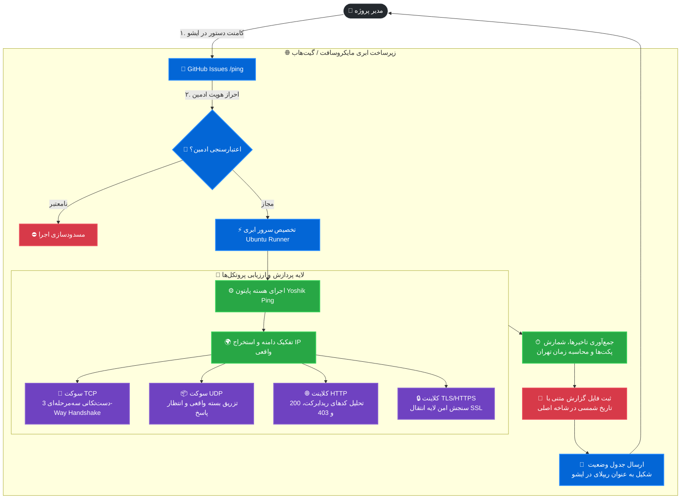

<div align="center">

# 🚀 Yoshik Ping Engine (v1.0)
### ⚡️ سامانه ابری ارزیابی سلامت شبکه، پایش پورت‌ها و رادار تحریم از دیتاسنترهای مایکروسافت

[](https://github.com/YoshikVPS/ping/actions)
[](https://python.org)
[](#-امنیت-و-پایبندی-به-قوانین-گیت‌هاب)
[](#-راهنمای-استفاده-و-کامندها)

<p align="center">
  <b>یک دستیار بدون‌سرور (Serverless) مبتنی بر ChatOps برای تحلیل وضعیت فایروال‌ها، ردیابی پورت‌ها، تاخیر میلی‌ثانیه‌ای و تحریم‌های شبکه از دید خارج از کشور</b>
</p>

[گزارش زنده پایش](#-نمونه-خروجی-زنده-در-ایشو) •
[معماری پروتکل‌ها](#-معماری-عملکرد-و-فلوچارت-موتور-تست) •
[نصب اختصاصی (Fork)](#-چگونه-این-پروژه-را-در-مخزن-خود-اجرا-کنیم؟) •
[امنیت و قوانین](#-امنیت-و-پایبندی-به-قوانین-گیت‌هاب)

</div>

---

## 🔮 معرفی پروژه

پروژه **Yoshik Ping** به شما امکان می‌دهد وضعیت پورت‌ها و سرویس‌های داخلی، سرورهای شخصی و دیتاسنترها را از طریق سرورهای قدرتمند مایکروسافت بدون نیاز به تهیه VPS خارجی، به طور دقیق مانیتور کنید. تنها کافی است یک کامنت در بخش **Issues** ارسال کنید تا موتور هوشمند پروژه فعال شده و نتایج را همراه با آی‌پی‌های متناظر و تاخیر (Latency) ریپلای کند.

---

## 🧭 معماری عملکرد و فلوچارت موتور تست

نحوه گردش داده و تعامل کاربر با موتورهای رانر مایکروسافت در ساختار زیر خلاصه شده است:



---

## 🔬 پروتکل‌ها چگونه سنجیده می‌شوند؟ (جزئیات فنی)

| پروتکل | نحوه آزمایش فنی در موتور | شرایط موفقیت (UP) | شرایط شکست (DOWN) |
| :---: | :--- | :--- | :--- |
| **`TCP`** | برقراری نشست سوکت کامل (`SYN ➔ SYN-ACK ➔ ACK`) | پورت باز است و پاسخ سریع می‌دهد | خطای `Connection Refused` یا فیلتر بودن پورت (Timeout) |
| **`UDP`** | ساخت و پرتاب پی‌لود معتبر بر بستر بایت‌های استاندارد شبکه | دریافت حداقل ۱ بایت پاسخ واقعی از مقصد | عدم بازگشت پکت و بروز خطای تایم‌اوت سوکت |
| **`HTTPS`** | هندشیک SSL + ارسال متد `GET` به همراه هدرهای مرورگر مدرن | دریافت پاسخ ۲xx، ۳xx و حتی ۴۰۳ (دسترسی وب زنده است) | خطاهای عدم تطابق گواهی SSL، قطعی کامل وب‌سرور |
| **`HTTP`** | ارسال درخواست مستقیم متن باز روی پورت مشخص‌شده | پردازش موفق کد پاسخ وب‌سرور | بسته بودن پورت یا ارور ۵۰۲ و عدم اتصال کلاینت |

---

## 📊 نمونه خروجی زنده در ایشو

پس از ارسال دستور، چنین کارتی در همان ایشو برای شما ثبت می‌شود:

> 🖥 **آی‌پی سرور مایکروسافت:** `20.163.133.232`  
> 📅 **تاریخ ارزیابی (شمسی):** `1405/08/19`  
> 🕒 **بازه پایش:** `22:10:02` ➔ `22:11:04` (به وقت رسمی ایران)  
> ⏱ **مدت زمان دقیق:** `1 دقیقه و 2 ثانیه` (`10` مرحله پایش دوره‌ای)

| هدف ارزیابی | آی‌پی مقصد (Resolved IP) | پروتکل | نرخ موفقیت | میانگین Latency | وضعیت اتصال |
| :--- | :---: | :---: | :---: | :---: | :--- |
| `parspack.com:443` | `194.26.195.206` | `HTTPS` | `10/10` | `667.16 ms` | 🟢 پایدار (موفق (کد 200)) |
| `parspack.com:443` | `194.26.195.206` | `TCP` | `10/10` | `163.05 ms` | 🟢 پایدار (پورت TCP باز است) |
| `217.218.155.155:53` | `217.218.155.155` | `UDP` | `10/10` | `196.69 ms` | 🟢 پایدار (پاسخ UDP دریافت شد) |
| `217.218.155.155:53` | `217.218.155.155` | `TCP` | `0/10` | `ناموفق` | 🔴 قطع (Connection refused) |

---

## 🛠 راهنمای استفاده و کامندها

کافیست وارد یکی از Issues شوید و در کامنت بنویسید:

### ۱. پایش چندگانه با زمان دلخواه:
```text
/ping parspack.com:443(https,http,tcp,udp),arvancloud.ir:443(https,tcp),217.218.155.155:53(udp,tcp) (تایم)-1
```
* **تایم:** عددی بین ۱ تا ۵۹ دقیقه به ازای مدت زمان تست زنده.
* **پروتکل‌ها:** می‌توانید هرکدام از ۴ پروتکل را داخل پرانتز تفکیک کنید.

### ۲. پاکسازی دو مرحله‌ای تاریخچه:
برای اینکه پوشه لاگ‌ها (`ping/`) ریپازیتوری را سنگین نکند:
1. بنویسید: `پاکسازی`
2. بات از شما تاییدی می‌خواهد. ظرف مدت ۶۰ ثانیه بنویسید: `بله` (برای تایید حذف) یا `خیر` (انصراف).

---

## 👥 چگونه این پروژه را در مخزن خود اجرا کنیم؟

اگر می‌خواهید این سیستم را برای خودتان بدون دستکاری کدهای اصلی داشته باشید:

1. **Fork کردن:** در بالای صفحه دکمه **Fork** را بزنید تا یک کپی از پروژه روی اکانت شما ساخته شود.
2. **فعال‌سازی دسترسی نوشتن ورک‌فلو:**
   - به بخش **Settings ➔ Actions ➔ General** مخزن خود بروید.
   - به انتهای صفحه بروید و گزینه **Read and write permissions** را انتخاب کرده و **Save** کنید.
3. **تعریف کلید مدیر (Secret):**
   - به مسیر **Settings ➔ Secrets and variables ➔ Actions** بروید.
   - یک سکرت جدید با عنوان **`ADMIN_USERNAME`** بسازید و مقدار آن را نام کاربری گیت‌هاب خودتان بگذارید.
4. **شروع:** یک Issue باز کنید و دستور پینگ خود را بفرستید!

---

## 🛡 امنیت و پایبندی به قوانین گیت‌هاب

| فاکتور امنیتی | میزان انطباق | نحوه مدیریت در پروژه |
| :--- | :---: | :--- |
| **قوانین Acceptable Use گیت‌هاب** | **۱۰۰٪ قانونی** | هیچ تست دیداس یا حمله‌ای صورت نمی‌گیرد؛ عملکرد کاملاً منطبق بر مانیتورینگ استاندارد سرورها است. |
| **جلوگیری از اسپم و اتک** | **تضمین‌شده** | بین تست‌ها فاصله‌گذاری هوشمند (۲ تا ۵ ثانیه Sleep) تعبیه شده است تا از مسدود شدن IP سرور جلوگیری شود. |
| **کنترل دسترسی مدیر** | **تایید دولایه** | اجرای اکشنز به طور سخت‌گیرانه مشروط به تطابق دقیق فرستنده با سکرت `ADMIN_USERNAME` است. |
| **مصرف منابع رایگان گیت‌هاب** | **فوق‌العاده کم** | رانر فقط در زمان نیاز اجرا شده و بلافاصله پس از اتمام تست و تحویل گزارش متوقف می‌شود. |

---

<div align="center">

ساخته شده با ❤️ برای جامعه توسعه‌دهندگان و مدیران شبکه  
**Yoshik VPS Network Lab**

</div>
