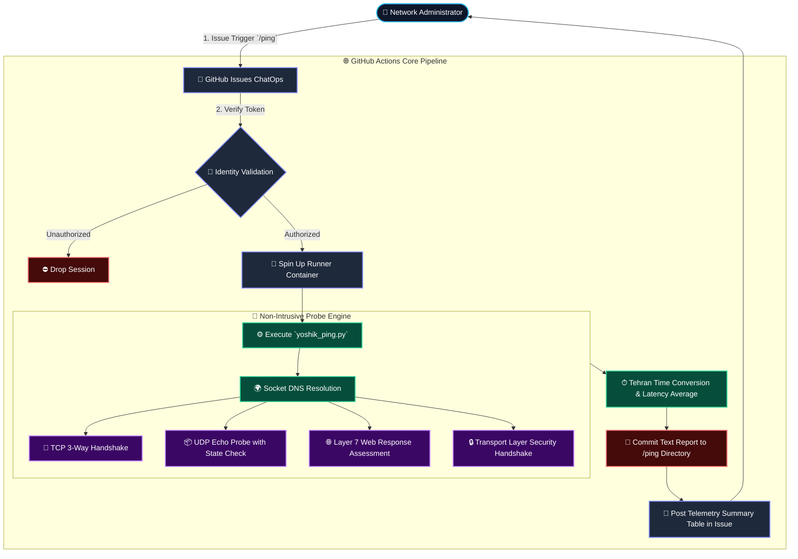

<div align="center">

# 🌐 Yoshik Ping Engine `v1.0-Release`
### Cloud-Native Network Telemetry & Multi-Protocol Availability Sentinel

[](https://github.com/YoshikVPS/ping/actions)
[](https://python.org)
[](https://github.com/features/actions)
[](#-github-compliance--security-statement)
[](https://github.com/YoshikVPS)

<p align="center">
  <b>A lightweight, serverless ChatOps network diagnostic system powered by GitHub Actions. Designed for non-intrusive latency measurement, layer 4/7 handshake auditing, and geo-reachability verification from global Microsoft Azure edges.</b>
</p>

[System Architecture](#-system-architecture) •
[Protocol Handlers](#-protocol-inspection-matrix) •
[Command Syntax](#-chatops-command-interface) •
[GitHub Compliance](#-github-compliance--security-statement) •
[راهنمای فارسی](#-راهنمای-جامع-فارسی-و-آموزش-استفاده-تخصصی)

</div>

---

## 🏛 System Architecture

The workflow leverages ephemeral Azure-hosted runner nodes to test destination networks without maintaining dedicated infrastructure:



---

## 🔬 Protocol Inspection Matrix

Yoshik Ping does not perform blind port knocks. Each probe executes precise, low-overhead socket handshakes:

| Protocol | Socket Technique | Evaluation Criteria (UP) | Failure Signature (DOWN) |
| :---: | :--- | :--- | :--- |
| **`TCP`** | Full OS Socket 3-Way Handshake (`SYN ➔ SYN/ACK ➔ ACK`) | Established connection within 3.5s timeout | `ConnectionRefusedError`, host down, or dropped SYN |
| **`UDP`** | Payload injection with socket response capture | Active datagram return (>= 1 byte payload) | Socket timeout (firewall drop / blackhole routing) |
| **`HTTPS`** | TLS v1.2/v1.3 Handshake + Layer 7 HTTP request | Returns valid status code (`2xx`, `3xx`, or even `403`) | SSL certificate expiry, TLS mismatch, or TCP drop |
| **`HTTP`** | Clear-text `HTTP/1.1 GET` request with modern User-Agent | Web daemon responds with standard status code | Target port closed or remote proxy drops raw HTTP |

---

## 🕹 ChatOps Command Interface

Execute diagnostics directly within any Issue thread using native syntax:

### 1. Multi-Target Comprehensive Audit
```text
/ping parspack.com:443(https,http,tcp,udp),arvancloud.ir:443(https,tcp),217.218.155.155:53(udp,tcp) (تایم)-1
```
* **Duration Token `(تایم)-<N>`:** Sets total audit loop duration between `1` and `59` minutes.
* **Protocol Token `(<protocols>)`:** Target-specific protocols delimited by commas (`tcp`, `udp`, `http`, `https`).

### 2. Interactive Safe Archive Cleanup
To prevent repository bloat, run the interactive cleanup routine:
1. Submit comment: `پاکسازی`
2. The engine responds with a verification request. Reply within 60 seconds:
   - `بله` ➔ Confirms and executes git purge of the `/ping/` directory.
   - `خیر` ➔ Aborts cleanup and preserves all logs.
   - Timeout (60s) ➔ Automatic cancellation without state change.

---

## 🛡 GitHub Compliance & Security Statement

> [!NOTE]
> **Notice for GitHub Security, Abuse Detection, and Policy Automation:**
> 
> * **Project Intent:** This repository operates strictly as a personal, developer-level uptime checker and network latency measurement tool. It is designed to verify cross-border routing to authorized internal infrastructure and public domains.
> * **No Hostile Scanning:** It does **NOT** conduct mass vulnerability scans, brute-force attacks, port range sweeps, or denial-of-service traffic. Probes are issued strictly against explicit hostnames/ports provided directly by the authenticated administrator.
> * **Rate Limiting:** Inherent throttling (`time.sleep` intervals of 2.0s to 5.0s per loop) ensures low packet transmission rates, well below standard ICMP/HTTP monitoring thresholds.
> * **Resource Efficiency:** Execution runs on-demand via comment events and shuts down promptly. No continuous or runaway cron schedules are active.
> * **Compliance Status:** Fully adheres to the [GitHub Acceptable Use Policies](https://docs.github.com/en/site-policy/acceptable-use-policies/github-acceptable-use-policies).

---

## 👨‍💻 Engineering & Authorship

- **Architecture & System Design:** [YoshikVPS](https://github.com/YoshikVPS)
- **Repository Source:** [https://github.com/YoshikVPS/ping](https://github.com/YoshikVPS/ping)
- **Engine Core:** Python 3.10 Standard Library (`socket`, `urllib`, `time`, `jdatetime`)

---

## 🇮🇷 راهنمای جامع فارسی و آموزش استفاده تخصصی

<details>
<summary><b>👈 برای مشاهده مستندات کامل فارسی، نحوه راه‌اندازی و پورت کردن کلیک کنید</b></summary>

<br>

### 📖 معرفی اجمالی پروژه
پروژه **یوشیک پینگ (Yoshik Ping)** یک ابزار سبک مانیتورینگ شبکه بر پایه معماری ChatOps است که روی زیرساخت رانرهای رسمی مایکروسافت/گیت‌هاب اجرا می‌شود. این ابزار به شما امکان می‌دهد بدون نیاز به خرید سرور مجازی خارج از کشور، وضعیت باز بودن پورت‌ها، دسترسی به وب‌سرویس‌ها، تحریم‌های بین‌المللی و تاخیر رفت‌وبرگشت (Latency) سرورها و فایروال‌های خود را ارزیابی نمایید.

---

### 🚀 نحوه پورت و راه‌اندازی روی اکانت شخصی (قدم به قدم)

اگر می‌خواهید این سیستم را بدون تغییر در کدهای اصلی برای خودتان داشته باشید و از سهمیه رایگان اکشنز مخزن خودتان استفاده کنید:

1. **انشعاب مخزن (Fork):**
   * در بالای همین صفحه روی دکمه **Fork** کلیک کنید تا یک نسخه کپی از مخزن وارد حساب کاربری شما شود.

2. **فعال‌سازی مجوزهای رایت در گیت‌هاب اکشنز:**
   * در ریپازیتوری فورک‌شده خود وارد بخش **Settings** شوید.
   * از منوی سمت چپ به مسیر **Actions** ➔ **General** بروید.
   * در پایین صفحه بخش **Workflow permissions** را پیدا کرده و گزینه **Read and write permissions** را انتخاب و ذخیره (**Save**) نمایید.

3. **تعریف کلید مدیر (Secret) جهت جلوگیری از سوءاستفاده:**
   * وارد بخش **Settings** ➔ **Secrets and variables** ➔ **Actions** شوید.
   * دکمه سبز رنگ **New repository secret** را بزنید:
     - نام سکرت (Name): `ADMIN_USERNAME`
     - مقدار سکرت (Secret): نام کاربری گیت‌هاب خودتان (مثلاً اگر آیدی شما `JohnDoe` است، همین را وارد کنید).
   * دکمه **Add secret** را بزنید.

4. **اجرای تست:**
   * به تب **Issues** بروید، یک Issue جدید باز کنید یا در یکی از ایشوها کامنت بگذارید:
   ```text
   /ping parspack.com:443(https,tcp),arvancloud.ir:443(https,tcp),217.218.155.155:53(udp,tcp) (تایم)-1
   ```
   * بات بلافاصله به شما پاسخ داده و پس از پایان ۱ دقیقه پایش، جدول نتایج را همراه با آی‌پی دقیق سرور مایکروسافت، آی‌پی رزولوشین دامنه‌ها و ساعت دقیق تهران ریپلای خواهد کرد.

---

### 🧹 مدیریت فضا و پاکسازی خودکار
برای جلوگیری از سنگین شدن مخزن، فایل‌های لاگ متنی درون پوشه `ping/` آرشیو می‌شوند. هر زمان مایل بودید این پوشه را پاک کنید:
1. در کامنت بنویسید: `پاکسازی`
2. سیستم از شما تاییدی می‌گیرد؛ تا ۶۰ ثانیه فرصت دارید با نوشتن **`بله`** حذف را تایید یا با نوشتن **`خیر`** عملیات را متوقف کنید.

</details>

---

<div align="center">

```
   Yoshik Network Labs • Engineered for Precision • Zero-Cost Cloud Telemetry
```

</div>
