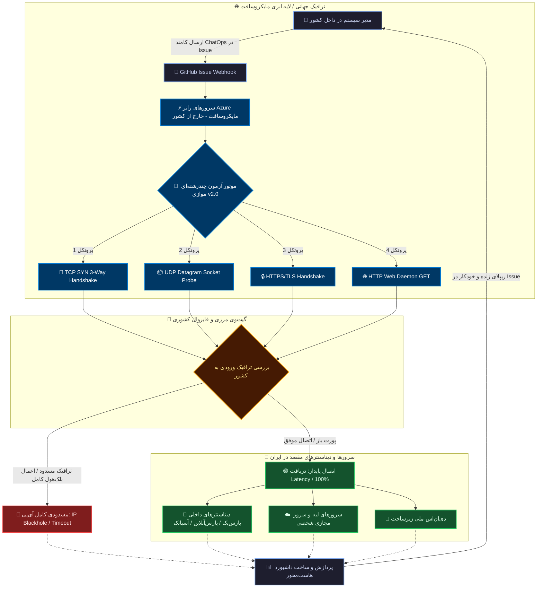

<div align="center">


<br/><br/>

#  یوشیک پینگ نسخه ۲.۰ &nbsp;|&nbsp; 🇬🇧 Yoshik Ping Engine `v2.0`
### سامانه ابری پایش عمیق ترافیک مرزی، پورت‌های موازی و رادار تحریم
**Serverless Cross-Border Deep Telemetry & Multi-Port Sentinel**

[](https://github.com/YoshikVPS/ping/actions)
[](https://python.org)
[](#compliance)
[](https://github.com/YoshikVPS)

<br/>

[](https://github.com/YoshikVPS/ping/fork)
[](https://github.com/YoshikVPS/ping/issues/new)

<br/>

**<a href="#persian-docs">📖 مطالعه مستندات جامع فارسی و سناریوی اینترنت ملی</a>** &nbsp; | &nbsp; **<a href="#english-docs">🇬🇧 Jump to English Documentation</a>**

</div>

---

<a id="english-docs"></a>

# 🇬🇧 English Technical Documentation

An on-demand, non-intrusive network health monitor running on Microsoft Azure runner nodes via GitHub Actions ChatOps. Built to diagnose latency, handshake status, multi-port availability, and cross-border edge reachability without requiring a dedicated external VPS.

---

### 🚀 Key Features in Version 2.0

* **Multi-Port Cartesian Probing:** Audit multiple ports per target concurrently using a comma-separated syntax (`host:443,80,53(protocols)`).
* **Deep Layer 3 & Layer 4 Inspection:** Differentiates between service inactive state (`Connection Refused`), active firewall drops (`Timeout`), and overall IP Blackholing.
* **Host-Centric Result Grouping:** Organizes telemetry per endpoint, calculating packet stability percentages and latency averages.
* **Safe Concurrency Pools:** Employs managed worker threads (capped at 12 workers) with rate-limiting backoffs to ensure full compliance with GitHub Acceptable Use Policies.

---

### 🕹 ChatOps Command Syntax

Initiate diagnostics by submitting a comment on any repository **Issue**:

#### 1. Multi-Port Inspection Command (v2.0 Syntax)
```text
/ping parspack.com:443,80(https,tcp) arvancloud.ir:443(https,tcp) 217.218.155.155:53(udp,tcp) (تایم)-1
```
* **Multi-Port Targets:** Group ports per domain: `hostname:port1,port2(protocols)`.
* **Flexible Delimiters:** Targets can be separated by spaces or commas.
* **Loop Duration:** `(تایم)-<N>` sets total audit duration in minutes (1 to 59).

#### 2. Interactive Archive Purge
```text
پاکسازی
```
* Prompts for confirmation. Reply with `بله` (Yes) within 60 seconds to purge the `/ping/` directory, or `خیر` (No) to abort.

---

### 🔬 Technical Inspection Matrix

Yoshik Ping avoids arbitrary port knocking; every probe executes lightweight, native socket handshakes:

| Protocol | Socket Verification Method | Success State (UP) | Failure Signature (DOWN) |
| :---: | :--- | :--- | :--- |
| **`TCP`** | Full OS Socket 3-Way Handshake (`SYN ➔ SYN/ACK ➔ ACK`) | Established connection `< 2.8s` | `Connection Refused` or dropped packet |
| **`UDP`** | Standard DNS query payload injection with response capture | Active datagram return (`>= 1B`) | Datagram socket timeout |
| **`HTTPS`** | TLS Handshake + Layer 7 HTTP verification | Valid web response status code | Protocol mismatch or drop |
| **`HTTP`** | Standard HTTP/1.1 clear-text GET request | Server response processed | Target port closed / inactive |

---

<a id="compliance"></a>

### 🛡 Security & GitHub Policy Compliance

> [!NOTE]
> **Notice for GitHub Trust & Safety and Policy Automation:**
> * **Zero-Abuse Architecture:** This repository is strictly a personal uptime checker and latency measurement tool. It does **NOT** conduct mass port scanning, vulnerability probing, or denial-of-service traffic.
> * **Targeted Diagnostics:** Probes are executed only against explicit endpoints provided by the authenticated repository owner.
> * **Rate Limiting:** Enforces strict intervals (`time.sleep` between 1.8s and 4.0s per loop) to ensure negligible overhead.
> * **Resource Throttling:** Runs strictly on-demand via comment events and shuts down promptly. No continuous or aggressive cron jobs are scheduled.
> * **Policy Status:** Fully compliant with [GitHub Acceptable Use Policies](https://docs.github.com/en/site-policy/acceptable-use-policies/github-acceptable-use-policies).

---
<br/>

<div align="center">
  <h2>═══════════════════════════════════════════════════════</h2>
</div>

<br/>

---

<a id="persian-docs"></a>

#  مستندات جامع فارسی | یوشیک پینگ نسخه ۲.۰

### 💡 ایده و فلسفه مهندسی: دیده‌بان ترافیک در شرایط اختلال شبکه و اینترنت ملی

در شرایطی که دسترسی به اینترنت بین‌الملل دچار اختلال شدید می‌شود یا وضعیت شبکه به سمت **سیاه‌چاله ترافیک بین‌الملل (National Intranet Isolation)** پیش می‌رود، یکی از بزرگ‌ترین چالش‌های مدیران سرور و متخصصان شبکه این است:  
> **«آیا سرور و دیتاسنتر من در داخل کشور، هنوز از خارج از مرزها ترافیک دریافت می‌کند؟ آیا پورت‌ها از بیرون مسدود شده‌اند یا کل آی‌پی در لبه مرزی فیلتر و بلک‌هول شده است؟»**

از آنجا که پلتفرم **GitHub** به عنوان ابزار کاری توسعه‌دهندگان معمولاً در دسترس می‌ماند، **یوشیک پینگ (Yoshik Ping v2.0)** با هویت بومی و با نشان پرچم شیر و خورشید، به عنوان یک رادار خارجی بدون هزینه (Serverless) عمل می‌کند:
1. شما بدون نیاز به اتصال مستقیم یا ابزارهای دورزدن تحریم، از داخل Issueهای گیت‌هاب دستور `/ping` را ثبت می‌کنید.
2. سرورهای رانر مایکروسافت (Azure Nodes) در خارج از کشور فعال می‌شوند.
3. ترافیک پایش عمیق و موازی (چندپورتی) از خارج از مرزها به سمت سرورهای داخل کشور پرتاب می‌شود.
4. داشبورد تحلیلی هاست‌محور به همراه درصد پایداری و وضعیت سلامت لایه ۳ (مسدودی IP) در همان ایشو برای شما ریپلای خواهد شد.

---

### 🧭 فلوچارت ۳ بعدی مسیر ترافیک خارجی به سمت سرورهای داخلی



---

### 🕹 نحوه ارسال دستورات در Issues (نسخه ۲.۰)

وارد تب **Issues** مخزن خود شوید و در بخش کامنت دستور را بفرستید:

#### ۱. دستور تست جامع چندپورتی (قابلیت جدید نسخه ۲.۰):
```text
/ping parspack.com:443,80(https,tcp) arvancloud.ir:443(https,tcp) 217.218.155.155:53(udp,tcp) (تایم)-1
```
* **تست چند پورت باهم:** برای یک دامنه چندین پورت را با کاما جدا کنید (`parspack.com:443,80,8080(https,tcp)`).
* **جداسازی با فاصله:** تارگت‌ها را می‌توانید با فاصله ساده از یکدیگر تفکیک کنید.
* **مدت زمان پایش:** با عبارت `(تایم)-1` مدت زمان را از ۱ تا ۵۹ دقیقه تنظیم کنید.

#### ۲. پاکسازی دو مرحله‌ای آرشیو:
جهت جلوگیری از پر شدن حجم مخزن:
```text
پاکسازی
```
* بات پاسخ داده و تاییدیه می‌خواهد؛ تا ۶۰ ثانیه فرصت دارید با ارسال **`بله`** تایید یا با **`خیر`** عملیات را متوقف نمایید.

---

### ⚙️ راه‌اندازی سریع روی اکانت شما (راهنمای استفاده اختصاصی)

<div align="center">

[](https://github.com/YoshikVPS/ping/fork)

</div>

1. روی دکمه سبز رنگ بالا کلیک کنید تا مخزن به اکانت شخصی شما فورک شود.
2. در مخزن فورک‌شده به مسیر **Settings ➔ Actions ➔ General** بروید و در بخش *Workflow permissions* گزینه **Read and write permissions** را انتخاب و ذخیره کنید.
3. به مسیر **Settings ➔ Secrets and variables ➔ Actions** بروید و سکرت زیر را ثبت کنید:
   * **Name:** `ADMIN_USERNAME`
   * **Secret:** نام‌کاربری گیت‌هاب شما (مثلاً: `YoshikVPS`)
4. وارد تب **Issues** شوید و دستور `/ping` را امتحان کنید!

---

<br/>

<div align="center">

```
================================================================================
           📡 YOSHIK VPS NETWORK ENGINEERING & CLOUD TELEMETRY LAB
================================================================================
```

| 👨‍💻 System Architect | 🌐 Organization | 🛡 Core License | ⚡️ Engine Status |
| :---: | :---: | :---: | :---: |
| [**YoshikVPS**](https://github.com/YoshikVPS) | **Yoshik VPS Network Lab** | **MIT Open Source** | **v2.0 Operational** |

<br/>

[](https://github.com/YoshikVPS)
[](https://github.com/YoshikVPS/ping)

<br/>

<sub>Engineered with precision • Serverless GitHub Actions Core • Tehran Time Synced</sub>

</div>
