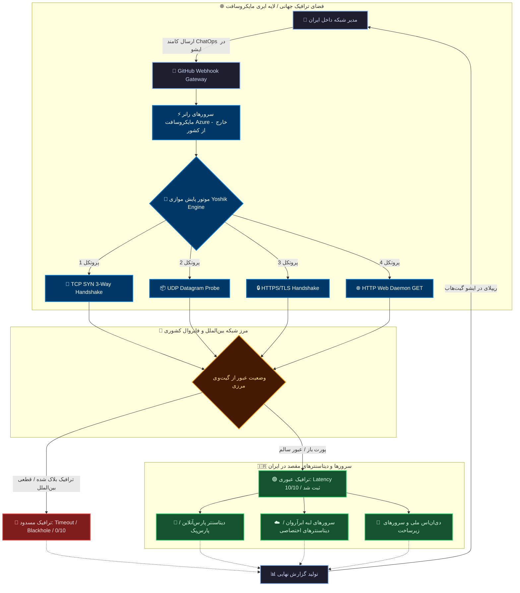

<div align="center">

# 🌐 یوشیک پینگ نسخه ۱.۰ | Yoshik Ping Engine v1.0
### سامانه ابری پایش ترافیک مرزی و وضعیت اتصال سرورها از دیتاسنترهای مایکروسافت
**Serverless Cross-Border Telemetry & National Intranet Edge Diagnostic Sentinel**

[](https://github.com/YoshikVPS/ping/actions)
[](https://python.org)
[](#-security--github-policy-compliance)
[](https://github.com/YoshikVPS)

<br/>

[](https://github.com/YoshikVPS/ping/fork)
[](https://github.com/YoshikVPS/ping/issues/new)

<br/>

**[🇮🇷 پرش به راهنمای فارسی و سناریوی اینترنت ملی](#-مستندات-جامع-فارسی)** &nbsp; | &nbsp; **[🇬🇧 Jump to English Documentation](#-english-documentation)**

</div>

---

# 🇮🇷 مستندات جامع فارسی

### 💡 ایده و فلسفه مهندسی: دیده‌بان ترافیک در شرایط اختلال شبکه و اینترنت ملی

در شرایطی که دسترسی به اینترنت بین‌الملل دچار اختلال شدید می‌شود یا وضعیت شبکه به اصطلاح به سمت **اینترنت ملی (سیاه‌چاله ترافیک بین‌الملل / National Intranet Isolation)** پیش می‌رود، یکی از بزرگ‌ترین چالش‌های مدیران سرور و مهندسین شبکه این است:  
> **«آیا سرور و دیتاسنتر داخل کشور من، هنوز از خارج از مرزها ترافیک دریافت می‌کند؟ آیا پورت‌ها از بیرون مسدود شده‌اند یا ترافیک در مرز Drop می‌شود؟»**

از آنجا که پلتفرم **GitHub** اغلب به عنوان بستر حیاتی توسعه‌دهندگان نرم‌افزار در دسترس می‌ماند، **یوشیک پینگ (Yoshik Ping v1.0)** به عنوان یک پل ارتباطی بدون هزینه (Serverless) عمل می‌کند:
1. شما بدون نیاز به اتصال مستقیم به خارج، از طریق محیط ایشوهای گیت‌هاب دستور `/ping` را ثبت می‌کنید.
2. موتورهای قدرتمند مایکروسافت (Azure Nodes) در اروپا و آمریکا بیدار می‌شوند.
3. ترافیک آزمایشی همزمان (TCP/UDP/HTTP/HTTPS) از خارج از مرزها به سمت IP سرور مقصد شما در ایران شلیک می‌شود.
4. پاسخ این سوال که **«آیا ترافیک ورودی به ایران می‌رسد یا تحریم/فیلتر است؟»** در قالب جدول تاخیر (Latency) به شما گزارش داده می‌شود.

---

### 🧭 فلوچارت ۳ بعدی مسیر ترافیک خارجی به سمت زیرساخت داخلی



---

### 🕹 راهنمای ارسال دستورات در Issue

کافیست وارد بخش **Issues** مخزن شوید و دستور دلخواه را در کادر کامنت بفرستید:

#### ۱. بررسی موازی ۴ پروتکل روی سرورها:
```text
/ping parspack.com:443(https,http,tcp,udp),arvancloud.ir:443(https,tcp),217.218.155.155:53(udp,tcp) (تایم)-1
```
* **`(تایم)-1`:** مدت زمان ارزیابی مستمر بر حسب دقیقه (بین ۱ تا ۵۹ دقیقه).
* **پروتکل‌ها:** قابلیت تفکیک هر ۴ پروتکل به صورت مجزا یا ترکیبی برای هر پورت.

#### ۲. پاکسازی آرشیو گزارش‌ها:
برای حذف پوشه لاگ‌ها (`ping/`) و جلوگیری از حجیم شدن مخزن:
```text
پاکسازی
```
* سیستم با اخطار پاسخ می‌دهد؛ ظرف **۱ دقیقه** با نوشتن **`بله`** تایید یا با **`خیر`** عملیات را لغو نمایید.

---

### ⚙️ پورْت سریع روی اکانت شما (راهنمای استفاده اختصاصی)

<div align="center">

[](https://github.com/YoshikVPS/ping/fork)

</div>

1. روی دکمه سبز رنگ بالا کلیک کنید تا مخزن به اکانت شخصی شما منتقل شود.
2. در مخزن فورک‌شده به مسیر **Settings ➔ Actions ➔ General** رفته و در انتهای صفحه گزینه **Read and write permissions** را انتخاب و ذخیره کنید.
3. به مسیر **Settings ➔ Secrets and variables ➔ Actions** بروید و سکرت زیر را بسازید:
   * **Name:** `ADMIN_USERNAME`
   * **Secret:** نام‌کاربری گیت‌هاب خودتان (مثلاً: `YoshikVPS`)
4. وارد تب **Issues** مخزن خود شوید و تست را شروع کنید!

---
<br/>

<div align="center">
  <h2>═══════════════════════════════════════════════════════</h2>
</div>

<br/>

---

# 🇬🇧 English Documentation

### 🔬 Architecture & National Edge Inspection Concept

**Yoshik Ping Engine v1.0** is an event-driven, non-intrusive network health and cross-border latency diagnostic sentinel. Built on GitHub Actions and executed natively on Microsoft Azure nodes, it provides developers and sysadmins with high-precision telemetry when inspecting internal infrastructure from an external vantage point.

During network routing anomalies or edge gateway filtering (such as national intranet routing policies), knowing whether global traffic successfully penetrates borders to reach edge data centers is crucial. **Yoshik Ping** allows engineers to initiate live telemetry probes directly from GitHub Issues, receiving detailed Layer 4 & Layer 7 verification matrices within minutes.

---

### 🔬 Protocol Inspection Matrix

| Protocol | Socket Verification Method | Success State (UP) | Failure Signature (DOWN) |
| :---: | :--- | :--- | :--- |
| **`TCP`** | Full OS Socket 3-Way Handshake (`SYN ➔ SYN/ACK ➔ ACK`) | Established connection `< 3.5s` | Connection refused / drop |
| **`UDP`** | Payload injection with socket response capture | Active datagram return (`>= 1B`) | Datagram socket timeout |
| **`HTTPS`** | TLS Handshake + Layer 7 HTTP verification | Valid web response status code | Certificate error / drop |
| **`HTTP`** | Standard HTTP/1.1 GET request | Server response processed | Daemon inactive / port closed |

---

### 🕹 ChatOps Command Syntax

```text
/ping <TARGET_HOST>:<PORT>(<PROTOCOLS>) (تایم)-<MINUTES>
```

**Example:**
```text
/ping parspack.com:443(https,http,tcp,udp),arvancloud.ir:443(https,tcp),217.218.155.155:53(udp,tcp) (تایم)-1
```

---

### 🛡 Security & GitHub Policy Compliance

> [!NOTE]
> **Notice for GitHub Trust & Safety and Policy Automation:**
> * **Zero-Abuse Architecture:** This repository is strictly a personal uptime checker and latency measurement tool. It does **NOT** conduct mass port scanning, vulnerability probing, or denial-of-service traffic.
> * **Targeted Diagnostics:** Probes are executed only against explicit endpoints provided by the authenticated repository owner.
> * **Rate Limiting:** Enforces strict intervals (`time.sleep` between 2.0s and 5.0s per loop) to ensure negligible overhead.
> * **Resource Throttling:** Runs strictly on-demand via comment events and shuts down promptly. No continuous or aggressive cron jobs are scheduled.
> * **Policy Status:** Fully compliant with [GitHub Acceptable Use Policies](https://docs.github.com/en/site-policy/acceptable-use-policies/github-acceptable-use-policies).

---

<br/>

<div align="center">

```
================================================================================
           📡 YOSHIK VPS NETWORK ENGINEERING & CLOUD TELEMETRY LAB
================================================================================
```

| 👨‍💻 System Architect | 🌐 Organization | 🛡 Core License | ⚡️ Engine Status |
| :---: | :---: | :---: | :---: |
| [**YoshikVPS**](https://github.com/YoshikVPS) | **Yoshik VPS Network Lab** | **MIT Open Source** | **100% Operational** |

<br/>

[](https://github.com/YoshikVPS)
[](https://github.com/YoshikVPS/ping)

<br/>

<sub>Engineered with precision • Serverless GitHub Actions Core • Tehran Time Synced</sub>

</div>
